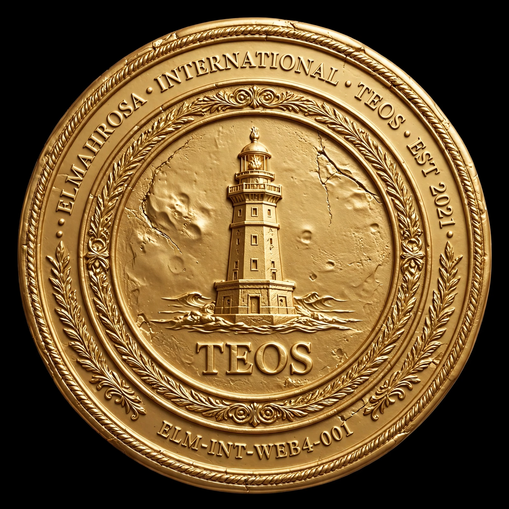

 

  

<h1 align="center">teos-node</h1>

<strong>Genesis Node Alexandria - Web4 .teos Resolver on Solana</strong>

<strong>ELM-INT-WEB4-001 | LAW OVER CODE</strong>

  
  
  
  
  
  

  
  
  

---

## ELMAHROSA TEOS NODE | ELM-INT-WEB4-001

### Alexandria Sovereign Node | Web4 Resolver

> **This is not a logo. This is a Sovereign Seal.**
> ELMAHROSA INTERNATIONAL • TEOS • EST. 2021
> Founder of WEB4 | Sovereign Architect from Alexandria

**Founder Type:** Individual Founder  
**Owner:** `AYMAN.TEOS` - `3jDzy...GLzG`  
**Network:** Solana Mainnet - Metaplex Core  
**Seal Date:** 25/10/2026 - Alexandria, Egypt  
**Standard:** ELM-INT-WEB4-001 - LAW OVER CODE  
**Status:** SEALED 1/1 GENESIS  
**Repository:** web4.elmahrosa.org

---

### 🔱 GENESIS COLLECTION

| Domain | Purpose | Status |
| :--- | :--- | :--- |
| **AYMAN.TEOS** | Genesis Seal - Non-transferable | SEALED |
| **CONSENSUS.TEOS** | Voting & Governance | ACTIVE |
| **EVENTS.TEOS** | Web4 Summits & Alexandria Events | ACTIVE |
| **MONEY.TEOS** | Treasury & Auction Payments `Aai9...MQ6` | ACTIVE |
| **PARTNER.TEOS** | B2B Partnerships - Banks & Telcos | ACTIVE |
| **CENTRALBANKS.TEOS** | 75 Central Banks Reserve | AUCTION |
| **RESERVED.TEOS** | 195 Premium EG + Global | RESERVED |

**Total Sovereign Reserve:** 270 Domains

---

### 🏦 CENTRAL BANKS RESERVE - 75 DOMAINS

`domains/central-banks-reserve.json`

**Value:** 75,000,000 EGP (1M per domain) - Auction Only  
**Includes:** `CBE.TEOS`, `FED.TEOS`, `ECB.TEOS`, `BOJ.TEOS`, `BOE.TEOS` + 70 more

---

### 🌍 INDIVIDUAL FOUNDER PACKAGE

**16 Domains - Owner Wallet: `3jDzy...GLzG`**

`AYMAN.TEOS / .EG / .SA / .AE / .QA / .KW / .BH / .OM`
`ELMAHROSA.TEOS / .EG / .SA / .AE / .QA / .KW / .BH / .OM`

View on `core.metaplex.com` - Standard: Metaplex Core (Phantom > Collectibles > Core)

---

### 📧 TEOS EMAIL SYSTEM

Use your domain as Web4 Identity:

`you@ayman.teos`
`contact@elmahrosa.teos`
`gov@cbe.teos`

Resolver: `web4.elmahrosa.org/resolve/[domain]`

---

### ⚖️ LICENSE - TESL v5.1.1

TEOS ELMAHROSA Sovereign License. LAW OVER CODE.

---

<strong>Built in Alexandria - ELMAHROSA INTERNATIONAL - EST. 2021</strong>
