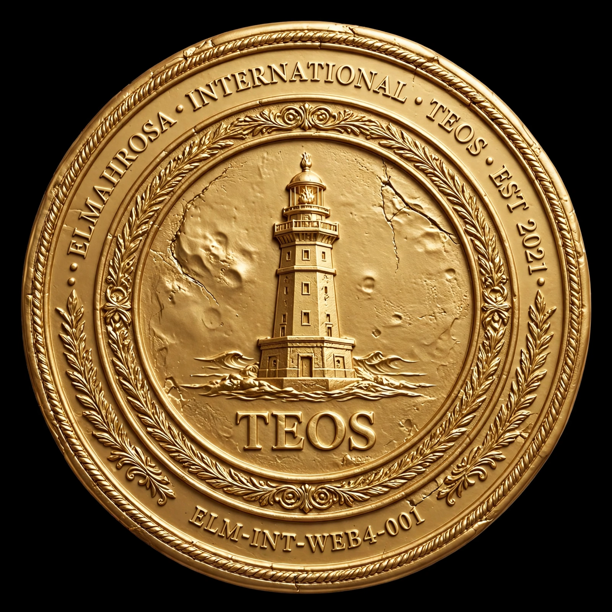

  

<h1 align="center">teos-node</h1>

<strong>Genesis Node Alexandria - TEOS name resolver on Solana</strong>

<strong>ELM-INT-WEB4-001</strong>

  
  
  
  

---

## Overview

`teos-node` is the application behind `web4.elmahrosa.org`. It sells and resolves **TEOS names**: digital identities inside the TEOS system on Solana, minted as Metaplex Core assets.

**Owner:** `AYMAN.TEOS` - `3jDzy...GLzG`
**Network:** Solana Mainnet - Metaplex Core
**Seal date:** 25/10/2026 - Alexandria, Egypt
**Repository:** web4.elmahrosa.org

> **Disclaimer.** TEOS names are digital identities inside the TEOS system on Solana. They are not internet TLDs, not the official domains of any country or government entity, and have no affiliation with ICANN or any national registry. Country codes such as .EG are internal namespace labels within TEOS only.
>
> أسماء TEOS هي هويات رقمية داخل منظومة TEOS على سولانا. وهي ليست نطاقات إنترنت من المستوى الأعلى (TLD)، وليست النطاقات الرسمية لأي دولة أو جهة حكومية، ولا ترتبط بأي صلة بـ ICANN أو بأي سجل وطني. رموز الدول مثل .EG هي تسميات لمساحات أسماء داخلية ضمن TEOS فقط.

---

## Namespaces

There is one root namespace, `.teos`, and 127 country namespaces listed in `namespaces/all.json`. A country namespace is unlocked for a buyer once they hold the same name under `.teos` (the root-unlock rule).

Country names are always shown with their TEOS context, for example `NAME.EG.TEOS`, or `NAME.EG` next to an "inside TEOS" mark.

## Quotes and payment

Payment is in SOL at the live rate. A quote locks its price for **5 minutes** (`QUOTE_TTL_SECONDS`, default 300, in `lib/quoteStore.ts`). Pay and register inside that window or request a new quote.

---

## Genesis collection

| Name | Purpose | Status |
| :--- | :--- | :--- |
| **AYMAN.TEOS** | Genesis Seal - Non-transferable | SEALED |
| **CONSENSUS.TEOS** | Voting & Governance | ACTIVE |
| **EVENTS.TEOS** | Summits & Alexandria Events | ACTIVE |
| **MONEY.TEOS** | Treasury & Auction Payments `Aai9...MQ6` | ACTIVE |
| **PARTNER.TEOS** | B2B Partnerships | ACTIVE |
| **RESERVED-ROOT.TEOS** | Reserved institutional collection | AUCTION |
| **RESERVED.TEOS** | Premium EG + Global | RESERVED |

### Reserved institutional collection

`domains/central-banks-reserve.json` lists 15 reserved names under neutral labels (`RESERVED-01.TEOS` and so on). They are auction only and are never sold through the public flow. The real names behind them are kept out of this repository and matched by SHA-256 hash (`domains/protected-hashes.json`, checked in `lib/sealed.ts`).

### Individual founder package

16 names, owner wallet `3jDzy...GLzG`:

`AYMAN.TEOS / .EG / .SA / .AE / .QA / .KW / .BH / .OM`
`ELMAHROSA.TEOS / .EG / .SA / .AE / .QA / .KW / .BH / .OM`

View on `core.metaplex.com` - Standard: Metaplex Core (Phantom > Collectibles > Core).

---

## TEOS email system

A TEOS name can be used as an email identity:

`you@ayman.teos`
`contact@elmahrosa.teos`

## Resolver

`web4.elmahrosa.org/resolve/[name]`

## Development

Node 22. `npm ci`, `npm run dev`, `npm test`.

## License

TESL v5.1.1 - TEOS ELMAHROSA Sovereign License. See `License.md`.

---

Built in Alexandria - ELMAHROSA INTERNATIONAL

